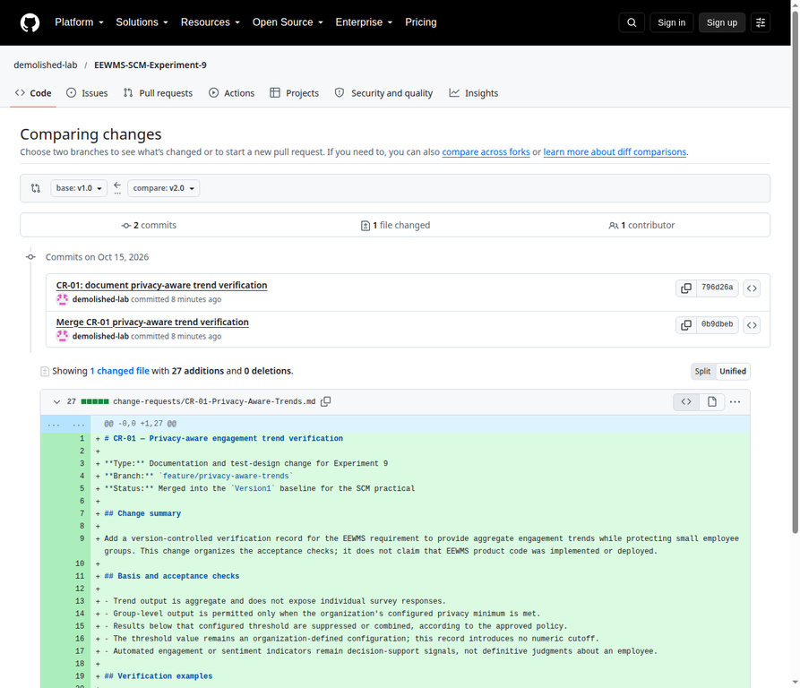
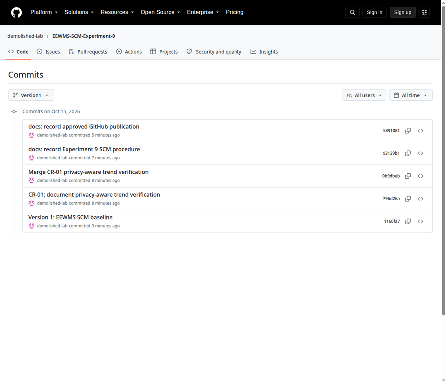

# Experiment 9 — GitHub for Version Control

## Student and case study

| Field | Value |
|---|---|
| Student | Rajababu Abhimanyu Barik |
| Roll number | 2403013 |
| Batch | C11 |
| Case study | Employee Engagement & Wellness Management System (EEWMS) |
| Repository | [demolished-lab/EEWMS-SCM-Experiment-9](https://github.com/demolished-lab/EEWMS-SCM-Experiment-9) |
| Visibility | Public |

## 1. Aim

To study Software Configuration Management (SCM) using Git and GitHub and apply repository creation, commits, branching, merging, tagging, and version-history inspection to EEWMS project documentation.

## 2. Theory

Git is a distributed version-control system. A repository records files and their history, while branches isolate changes until they are reviewed and merged. Tags identify named baselines or releases.

| Git stage | Role |
|---|---|
| Working directory | Files are edited locally. |
| Staging area (index) | Selected changes are prepared with `git add`. |
| Repository (`.git`) | `git commit` records a snapshot and its history. |

## 3. Configuration items

The practical tracks the items listed in [`docs/CI_Register.md`](../docs/CI_Register.md). The baseline includes the EEWMS SRS summary and CI register. CR-01 adds a privacy-aware aggregate-trend verification record on a feature branch. The repository contains documentation only; it includes no employee wellness data, credentials, or production code.

## 4. Procedure and observed Git record

### Step 1 — Initialize the baseline

The local repository was initialized on branch `Version1`. The initial status showed the README, CI register, and SRS summary as untracked. They were staged and committed as the baseline.

```text
git init -b Version1
# Initialized empty Git repository

git add .gitignore README.md docs/CI_Register.md docs/EEWMS_SRS_Summary.md
git commit -m "Version 1: EEWMS SCM baseline"
# [Version1 (root-commit) 1166fa7] Version 1: EEWMS SCM baseline
# 4 files changed, 81 insertions(+)

git tag -a v1.0 -m "Version 1: EEWMS SCM baseline"
```

### Step 2 — Develop CR-01 on a feature branch

CR-01 records verification checks for privacy-aware aggregate engagement trends. It uses an organization-configured minimum and adds no invented numeric threshold. It is a documentation/test-design change only; no EEWMS product implementation is claimed.

```text
git switch -c feature/privacy-aware-trends
# Switched to a new branch 'feature/privacy-aware-trends'

git add change-requests/CR-01-Privacy-Aware-Trends.md
git commit -m "CR-01: document privacy-aware trend verification"
# [feature/privacy-aware-trends 796d26a]
# 1 file changed, 27 insertions(+)
```

### Step 3 — Merge the change and tag the release

A non-fast-forward merge commit was used so the branch integration remains visible in the history graph.

```text
git switch Version1
git merge --no-ff feature/privacy-aware-trends \
  -m "Merge CR-01 privacy-aware trend verification"
# Merge made by the 'ort' strategy.
# 1 file changed, 27 insertions(+)

git tag -a v2.0 -m "Version 2.0: CR-01 merged"
```

### Step 4 — Verify history and compare versions

```text
git status --short --branch
## Version1

git branch -avv
* Version1                     0b9dbeb Merge CR-01 privacy-aware trend verification
  feature/privacy-aware-trends 796d26a CR-01: document privacy-aware trend verification

git tag -n
v1.0  Version 1: EEWMS SCM baseline
v2.0  Version 2.0: CR-01 merged

git log --oneline --all --graph --decorate
*   0b9dbeb (HEAD -> Version1, tag: v2.0) Merge CR-01 privacy-aware trend verification
|\
| * 796d26a (feature/privacy-aware-trends) CR-01: document privacy-aware trend verification
|/
* 1166fa7 (tag: v1.0) Version 1: EEWMS SCM baseline

git diff --stat v1.0 v2.0
 change-requests/CR-01-Privacy-Aware-Trends.md | 27 +++++++++++++++++++++++++++
 1 file changed, 27 insertions(+)
```

## 5. Version history

| Version point | Branch/tag | Commit | Description |
|---|---|---|---|
| Baseline | `Version1`, `v1.0` | `1166fa7` | EEWMS SCM baseline and configuration items |
| Change request | `feature/privacy-aware-trends` | `796d26a` | Added CR-01 verification record |
| Release | `Version1`, `v2.0` | `0b9dbeb` | Merged CR-01 using a visible merge commit |
| Documentation | `Version1` | `93139b1`, `5891081` | Added the experiment report and recorded publication status after the release tag |
| Screenshot evidence | `Version1` | `0b7c2d5` | Added direct GitHub comparison/history screenshots and repository links |
| Verification note | `Version1` | `1b46345` | Recorded the screenshot evidence commit; tags remained unchanged |

The `v2.0` tag remains on the CR-01 merge commit; later report/evidence commits do not move the release tag.

## 6. GitHub publication verification

The public repository was created and verified at the URL shown above. GitHub reports visibility **PUBLIC** and default branch **`Version1`**. Remote branches are `Version1` and `feature/privacy-aware-trends`. Remote annotated tags are `v1.0` and `v2.0`.

The first remote-ref verification captured `Version1` at `5891081`. The later screenshot-evidence commit `0b7c2d5` and verification-note commit `1b46345` were documentation-only; neither moved the feature branch or release-tag targets.

At the remote-ref verification checkpoint, the branch and peeled tag targets were:

```text
5891081  refs/heads/Version1
796d26a  refs/heads/feature/privacy-aware-trends
1166fa7  refs/tags/v1.0^{}
0b9dbeb  refs/tags/v2.0^{}
```

The screenshot directory contains direct captures of the actual public GitHub pages, not mockups:

**Figure 1 — CR-01 diff from the `v1.0` baseline to `v2.0`.**



**Figure 2 — Commit history on `Version1`.**



Screenshot source URLs and capture notes are recorded in [`screenshots/README.md`](screenshots/README.md).

## 7. Conclusion

The practical established an EEWMS documentation baseline, isolated CR-01 on a feature branch, merged it into `Version1`, tagged the baseline and release, and verified the resulting public GitHub branches, tags, history, and diff. This demonstrates how Git and GitHub support controlled changes and traceable project-document versions.
